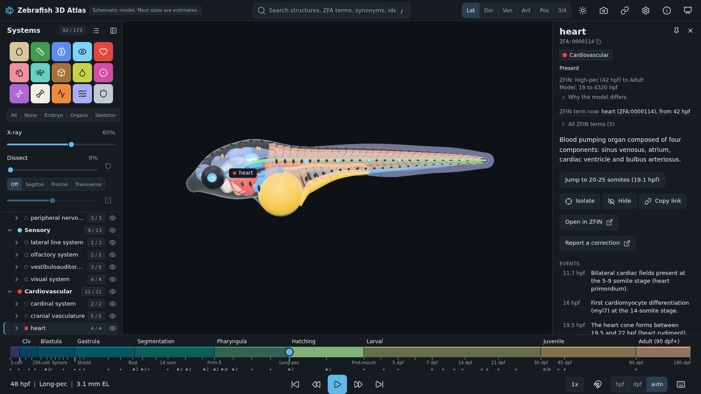
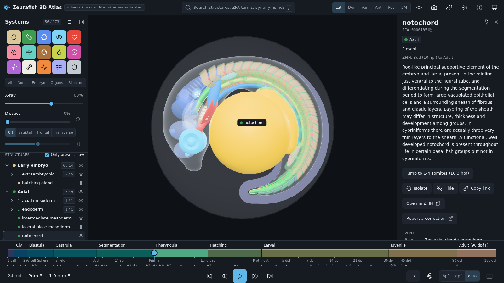
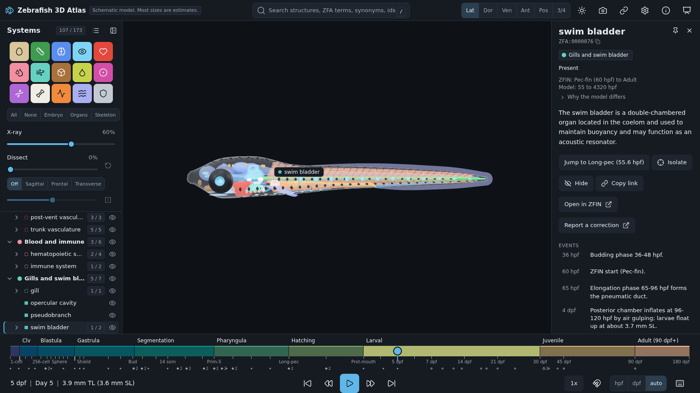
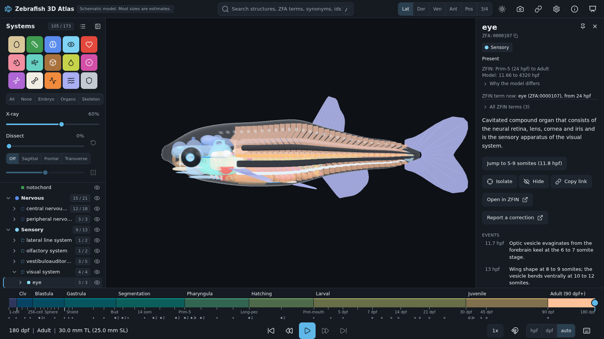

# Zebrafish 3D Atlas

An interactive 3D model of zebrafish development, from the 1-cell zygote (0 hpf) to the adult
(180 dpf). Scrub the time axis and structures appear, grow and change shape. Each one carries its
ZFIN anatomy ontology (ZFA) term, definition, stage window and sources.

**Try it:** open the hosted viewer at <https://zebrafish-3-d-atlas.vercel.app/>. It needs a
browser with WebGL 2, and it follows the `main` branch. For offline use, download the single-file
build from the [releases page](https://github.com/yangjun9095/zebrafish-3D-atlas/releases) and
open `zebrafish-3d-atlas.html`. That file runs with no server. It is version 0.1.0 of 2026-09-09,
so it does not hold the Reporter preview.



## What it is, and what it is not

This is a teaching and talk aid. It is not a validated model for quantitative research. Every
shape is procedural and schematic: no imaging volume, no segmentation, no measured mesh. Motion
between keyframes is a smoothstep interpolation of hand-set parameters, so the viewer does not
simulate morphogenesis. 88 percent of the size values (490 of 559 rows) are estimates, and the
info card flags every one. Do not measure anything from it.

Checked: the 221 ZFA ids, the 44 ZFS stage names and every stage window. `npm run validate`
checks them against the ZFIN snapshot in `data/zfin/`. Not checked: no independent anatomist has
reviewed the geometry.

## Who built it

I built it over three days, 2026-09-06 to 2026-09-08, with AI coding agents (Claude Code) working
under my direction. The starting point was [human-atlas](https://github.com/ashemag/human-atlas)
by Ashe Magalhaes, an interactive 3D viewer of human anatomy. I asked the agents for a zebrafish
counterpart with a time axis, for talks and teaching.

I set the scope, chose the sources and reviewed each change. The agents wrote the application
code, the data records and the research notes in `docs/research/`. They wrote every shape as a
procedural model with parameters from the literature. They then adjusted the parameters by eye
against four reference illustrations that I supplied.
[How this was built](#how-this-was-built) says what that means for each kind of number.

The Reporter preview and the movie pipeline followed between 2026-09-09 and 2026-09-18. AI coding
agents wrote them as well, under the same direction and review.

This is a personal project by a scientist at Chan Zuckerberg Biohub San Francisco. It is not a CZ
Biohub product, and neither CZ Biohub nor ZFIN has reviewed or endorsed it.

## Cite it, correct it

Cite this work through [`CITATION.cff`](CITATION.cff), and cite ZFIN and Kimmel et al. 1995
alongside it. The code is MIT. The ZFIN-derived data is CC BY 4.0 and CC BY 3.0; see
[`LICENSE-DATA`](LICENSE-DATA).

Report a structure drawn in the wrong place or at the wrong stage through the
[anatomy correction form](../../issues/new?template=anatomy-correction.yml). A ZFA id, a stage in
hpf and a citation are enough. A correction to the anatomy is the most useful contribution anyone
can make.

## Features

- Time axis from 0 to 4320 hpf with the 44 named ZFS stages, 10 periods, headline ticks,
  playback at five speeds, snap to stage, and a readout in hpf, dpf or both.
- A procedural body model: the yolk, the blastoderm, the wrapped axis, the straightening embryo and
  the free-swimming fish, scaled by standard length after 72 hpf.
- 221 anatomy records in 15 systems (173 drawn structures and 48 group nodes), one record per ZFA
  id, with the ZFIN definition, stage window, synonyms, size rows, events and sources on the info card.
- Developmental handoffs (D9): the heart tube forms the four parts of the heart (sinus venosus,
  atrium, ventricle and bulbus arteriosus; the zebrafish heart has two chambers), the optic cup
  becomes retina, lens and pigment epithelium, the otic vesicle becomes the inner ear, the somites
  become myotomes, the fin fold becomes the dorsal, anal and caudal fins, the pronephros becomes
  the mesonephros, and the immature gonad becomes an ovary or a testis (sex toggle: female, male
  or both).
- Systems rail with a present-now count per system, hide and solo per system, rail presets,
  x-ray, a section plane, and a hierarchy tree with a present-now filter.
- Search over names, synonyms, alias names, ZFA ids and system names, with "Jump to first
  appearance" for a structure that is absent at the current time. Search also covers the full ZFA
  vocabulary of ZFIN (3113 terms on 2026-09-06, not only the 221 modeled records): a term with no
  geometry opens its info card and names the nearest modeled ancestor.
- A Dissect slider (0 to 100 percent) that separates the structures away from the spine and, past
  60 percent, gathers them into a shelf-packed inventory grid beside the body, sorted by system,
  with labels on. The body model itself never moves.
- Six view presets, orbit and zoom keys, follow-growth framing, and a dark and a light theme.
- Share links that encode time, selection, camera, visibility, theme and settings. PNG export at 1x,
  2x and 4x, at fixed slide sizes (1920 by 1080, 3840 by 2160) and frames (16:9, 4:3, 1:1), with an
  optional transparent background, labels, scale bar, readout and legend.
- Presentation mode with a fullscreen toggle, a black screen, a hidden or pinned timeline strip, a
  projector scale, and slide kits: bookmarks with thumbnails, two starter kits, JSON and ZIP export.
- An embed mode (`?embed=1`) whose footer carries an "Open in Zebrafish Atlas" link, the line
  "Schematic model" and the ZFIN attribution.

The viewer is a static web page with no backend. It runs in any browser with WebGL 2.

## Screenshots

The whole window at four stages, with a structure selected in each. `docs/screenshots/` also
holds the 36 headline views of the model alone (18 stages, lateral and dorsal), and
`docs/screenshots/systems/` holds each system alone at 48, 120 and 4320 hpf.

| 24 hpf (Prim-5) | 48 hpf (Long-pec) |
| --- | --- |
|  |  |

| 120 hpf (Day 5) | 4320 hpf (adult) |
| --- | --- |
|  |  |

The adult frame is the least finished part of the model. It draws two stripes and no stripes on
the fins; the adult fish has five stripes. The notochord is drawn as one continuous rod to 2160
hpf and then stops, so the model shows nothing of the remnants pinched between the centra. Both
reworks are open.

## Controls

### Main controls

Press `?` in the app for the full sheet. The main keys:

| Keys | Action |
| --- | --- |
| Space | Play or pause |
| Left, Right | Previous or next stage (bookmarks with a kit in presentation mode) |
| Shift+Left, Shift+Right | Step 1 hpf before 72 hpf, 1 dpf after |
| PageUp, PageDown | Previous or next period |
| Home, End, Shift+End | Axis start, adult start, axis end |
| [ , ] | Speed down, speed up |
| S, U | Snap to stage, cycle units |
| Up, Down | Step the time up or down (timeline focused) |
| Shift+Down | Open the events nearest the thumb (timeline focused) |
| 1 to 6 | Lateral, dorsal, ventral, anterior, posterior, three-quarter view |
| R, Shift+R, F | Reset camera, reset all, fit camera to body |
| Alt+Arrows, Alt++, Alt+- | Orbit by 15 degrees, zoom by 10 percent |
| X, L, T | Toggle x-ray, 3D labels, theme |
| D, Shift+D | Step the Dissect slider 0, 30, 60, 100 percent (Shift steps back) |
| Ctrl+K or / | Focus search |
| I, H | Isolate or hide the selection |
| Ctrl+C | Copy "name (ZFA id)" of the selection |
| Esc | Exit isolate, close the sheet, clear the selection, exit presentation (one per press) |
| P, Shift+P | Presentation mode, pin the timeline strip |
| Enter, Shift+F | Fullscreen (Enter in presentation mode) |
| B or . | Black screen (presentation mode) |
| Ctrl+B, Shift+B | Add a bookmark, open the slide kit sheet |
| Shift+C, Ctrl+Shift+S | Share link, export PNG |
| , | Settings |

URL parameters: `t` (hpf), `v` (lat, dor, ven, ant, pos, tq), `sel` (ZFA numbers), `term` (a ZFA
vocabulary term the atlas does not draw), `hide` (system ids or ZFA numbers), `cam`, `xr`,
`x` (dissect percent), `sec`, `iso`, `theme`, `u`, `snap`, `labels`, `temp`, `sex` (f, m, b),
`embed`, `present`, `pin`, `ps`, `kit`. The address bar follows the app state.

## Reporter preview (experimental)

Open the app with `?lab=1` (or append `&lab=1` to a link that already has parameters). The flask
button opens the **Reporter preview** panel, marked "Experimental". Choose **Try heart + liver +
spinal cord** for an example at 48 hpf, or search the existing modeled anatomy by name, synonym
or ZFA ID to add a target. Each row chooses a fluorescent protein and an inclusive hpf window.
**This time only** sets a single snapshot; **Include modeled parts** includes descendants in the
current anatomy tree and lists every mapped region.

Duplicate rows to reuse a reporter at other times or tissues, or assign multiple proteins to one
tissue. **Show fluorescence** switches between the anatomy colors and the preview; **View
channel** selects a single reporter or the composite. **Fish context** controls the faint
unlabeled anatomy. Colored bands mark target windows on the timeline. Hidden structures and
systems, isolation, section planes and anatomical availability still apply; the whole-organism
skin record is never a target.

Eight reporters are available, each labeled with its emission peak: mTagBFP2 (454 nm), mTurquoise2
(474 nm), EGFP (507 nm), mVenus (528 nm), mKO2 (565 nm), mScarlet (594 nm), mCherry (610 nm) and
iRFP670 (670 nm, near-infrared, shown as a magenta pseudocolour). The panel does not model spectral
overlap: two reporters 20 nm apart display as distinctly as two 100 nm apart.

Share links and slide-kit bookmarks retain the rules. PNG export uses the preview colors, can
offer a reporter legend, and credits the image "Schematic reporter preview | pattern defined by
the user, not imaging data". Sketch where and when a reporter lights up: the viewer draws your
choice and predicts nothing. It does not predict enhancer activity, cell-level expression,
reporter kinetics or fluorescence brightness. The ordinary viewer keeps these experimental
controls hidden.

Build the standalone preview the same way as the regular single-file demo (see "Build a
single-file demo"), then verify it:

```sh
node scripts/verify-fluorescence.ts bundle/zebrafish-3d-atlas.html
```

The check exercises target rules, channel mixing, time boundaries, share reloads, PNG export and
phone controls, and saves inspection images in a temporary directory.

`scripts/movies/README.md` describes the movie pipeline that drives this preview frame by frame:
one tissue lit in one reporter from 0 to 48 hpf, the batch over a tissue list, and a wild-type
movie with no reporter.

## Run locally

Requires Node.js 22.12 or newer.

```sh
npm ci
npm run dev
```

`npm run dev` binds to localhost on port 5173. Use `npm run dev:lan` to reach the dev server from
another device on the network. `npm run preview` serves the built site on localhost port 4173.

## Verify

```sh
npm run check        # TypeScript
npm run lint         # ESLint
npm test             # Vitest unit tests
npm run validate     # data validation against the ZFIN source files (exit 1 on any error)
npm run build        # static site in dist/
npm run test:e2e     # Playwright with the system Chrome: smoke, phone layout, screenshots, panels
npm run screenshots  # only the 36 headline screenshots, written to docs/screenshots/
npm run attribution  # writes public/ATTRIBUTION.md from src/core/attribution.ts
npm run notices      # writes public/THIRD-PARTY-NOTICES.txt from the production dependencies
npm run gen:body     # writes src/data/body.json from the body model
npm run gen:vocab    # writes src/data/vocabulary.json from the ZFIN snapshot
npm run sources      # writes docs/SOURCES.md from the record files
npm run gate         # every check above in CI order, in check mode for the generated files
npm run bundle       # single-file demo in bundle/ (add -- --verify to open it in Chrome once)
```

Run `npm run notices` after any change to the `dependencies` block of `package.json`. The gate
runs `npm run notices -- --check` and fails when `public/THIRD-PARTY-NOTICES.txt` is out of date.

Five generators write files that are committed: `gen:body`, `gen:vocab`, `sources`, `attribution`
and `notices`. The gate and the CI verify job run each of them with `-- --check`, which rebuilds
the output in memory and exits 1 when the committed file differs. Run the generator itself after
any change to its input, and commit the result in the same change.

`npm run validate` reports a handoff id that is not a record as the error E021; pass
`--lenient-handoffs` to keep it a warning for a data directory under construction.
`npm run validate -- --emit-schema` rewrites the JSON Schema files under `docs/schema/` after a
change to `src/core/schema/`. The browser tests need a prior `npm run build`; they start
`npm run preview` on port 4173 when nothing answers there.

`node scripts/snap.ts --port <port> --out <dir> [--hpf 24,48] [--views lat,dor] [--embed 0|1]
[--sel 0000114] [--systems]`
builds into its own directory and takes screenshots without touching `dist/`; `--systems` writes
one lateral view per system with the other systems hidden.

## Build a single-file demo

`npm run build` splits the app into many chunks, so `dist/index.html` keeps a script tag and a
list of `modulepreload` links that only a server can resolve. `npm run bundle` builds with
`VITE_SINGLE_FILE=1`, which turns the chunk groups off, then folds `dist/index.html` and its one
JS and one CSS file into `bundle/zebrafish-3d-atlas.html` (the file attached to the release, which
opens with no server):

```sh
npm run bundle              # writes bundle/zebrafish-3d-atlas.html
npm run bundle -- --verify  # also opens that file in Chrome and screenshots it
```

`--verify` opens the written file from the file system, waits for the viewer to draw, writes a
PNG beside it, and exits 1 on a page error or a blank canvas. `--out <file>` writes somewhere
else, and `--dist <dir>` reads another build directory.

The bundle embeds `ATTRIBUTION.md` and `THIRD-PARTY-NOTICES.txt` in two `<script type="text/plain">`
blocks, so the attribution and the licence notices travel with the file. The Attribution and
third-party notices links in the About sheet and the info card open those blocks in a panel when
the page has no files beside it.

The result runs from the file system with no server and no network request, except the
WebGL-failure fallback image, which stays an external file. CI runs `npm run bundle` on every
push and uploads `bundle/zebrafish-3d-atlas.html` as the `single-file-demo` workflow artifact
(`.github/workflows/ci.yml`).

## Deploy

- **Vercel**: `vercel.json` points Vercel at `npm run build` and `dist/`; connect the repository
  and deploy with no other setup. The hosted viewer at <https://zebrafish-3-d-atlas.vercel.app/>
  is deployed this way, and Vercel rebuilds it on every push to `main`.
- **GitHub Pages**: needs a public repository or a plan that allows Pages on private ones. The workflow no longer deploys; when Pages becomes available, build with `VITE_BASE_PATH=/zebrafish-3D-atlas/ npm run build` and publish `dist/` with the Pages actions or by hand.
- **Anywhere else**: `npm run build` writes a static site to `dist/`; serve it from any static
  host, or send the single-file demo above.

## Data provenance

Every input to the viewer is listed here with its exact source, the date it was retrieved, its
licence and the evidence for that licence, what the viewer took from it, where the copy lives in
this repository, and how it was processed. Per-record sources are indexed in `docs/SOURCES.md`
(generated by `npm run sources`): 221 records and 1363 distinct source strings, of which 418 are
URLs, 75 are citations and 870 are modelling notes. Every record cites at least one URL. Many size
values are estimates and carry an `estimate` flag (490 of 559 size rows); the validator and the
generated index count them.

### Inputs that are in the repository or the built site

| Input | Exact source | Retrieved | Licence and evidence | What the atlas took | Where it lives | Processing |
|---|---|---|---|---|---|---|
| ZFIN bulk files: `anatomy_item.txt`, `stage_ontology.txt`, `anatomy_relationship.txt`, `anatomy_synonyms.txt` | https://zfin.org/downloads | 2026-09-06 | CC BY 4.0 for ZFIN data and annotations, stated at https://zfin.atlassian.net/wiki/spaces/general/pages/1942160112 | ZFA term ids, names, synonyms, part_of, is_a and develops_from relations, start and end stages; ZFS stage ids, names and hpf bounds at 28.5 C | `data/zfin/` (unchanged copies) | read by `scripts/validate-data.ts` and `scripts/build-vocabulary.ts`; ids and windows copied into `src/data/structures/*.json` and `src/data/stages.json` |
| Zebrafish Anatomy Ontology (ZFA) and Stage Ontology (ZFS), OBO release 2026-07-16 | http://purl.obolibrary.org/obo/zfa.obo | 2026-09-06 | CC BY 3.0, stated in the OBO file header | term definitions and relations | `data/zfin/zfa.obo`; definitions in `src/data/vocabulary.json` and in the records | the two paths differ. `src/data/vocabulary.json` removes the HTML markup, then keeps the first sentence of each definition; a first sentence over 240 characters is cut at the last sentence end that fits. The definitions of the 221 records in `src/data/structures/*.json` are not cut to that length: many run longer and carry more than one sentence, and some drop a trailing sentence of the ZFA text. Both modifications are stated in `public/ATTRIBUTION.md` and `LICENSE-DATA` |
| ZFIN staging series pages (reprint of Kimmel et al. 1995) | https://zfin.org/zf_info/zfbook/stages/index.html and its period pages | 2026-09-06 | Copyright 1995 Wiley-Liss, Inc., reprinted by ZFIN with permission; not part of the ZFIN CC BY 4.0 grant | facts only: stage times, embryo lengths, head-trunk angles, somite counts, landmark events | `src/data/stages.json`, `src/data/body.json` (through `scripts/gen-body.ts`) | landmarks restated in the atlas's own words; no sentence, table image or figure reproduced (checked for shared runs of six or more words) |
| Kimmel CB, Ballard WW, Kimmel SR, Ullmann B, Schilling TF (1995) Stages of embryonic development of the zebrafish. Dev Dyn 203:253-310 | doi:10.1002/aja.1002030302 | read 2026-09-06 through ZFIN and the abstract | Wiley; numbers are facts and are not licensed content | stage timings, embryo lengths, head-trunk angles, somite rates | `src/data/stages.json`, `src/data/body.json` | numbers only; cited per stage |
| Parichy DM, Elizondo MR, Mills MG, Gordon TN, Engeszer RE (2009) Normal table of postembryonic zebrafish development. Dev Dyn 238:2975-3015 | doi:10.1002/dvdy.22113 | read 2026-09-06 through the abstract and PubMed Central | Wiley; numbers only | standard-length milestones: flexion, fin ray formation, pelvic fin bud, squamation onset, juvenile onset | `src/data/stages.json` events and growth table; fin, skeletal and pigment records | numbers only; cited per event and keyframe |
| Singleman C, Holtzman NG (2014) Growth and maturation in the zebrafish, Danio rerio. Zebrafish 11:396-406 | doi:10.1089/zeb.2014.0976 | read 2026-09-06 | Mary Ann Liebert; numbers only | standard-length thresholds: 12 mm at 45 dpf, 18 mm at 90 dpf | `src/data/stages.json` growth table | numbers only |
| Other primary papers and ZFIN term pages cited per record | listed in `docs/SOURCES.md` | 2026-09-06 to 2026-09-08 | publisher pages read for numbers only | sizes, positions, timings | `sources` arrays in `src/data/structures/*.json` | numbers only; where no measurement was found the value is an estimate and is flagged |
| Zebrahub single-cell annotation table (Lange M, ..., Kim YJ, ..., Royer LA. 2024. A multimodal zebrafish developmental atlas. Cell 187(23):6742-6759.e17, Table S1) | doi:10.1016/j.cell.2024.09.047; the file was obtained through the bioRxiv supplementary material of the same table (doi:10.1101/2023.03.06.531398) | 2026-09-07 | the version of record is CC BY 4.0 (Crossref licence record, from 2024-09-28). The repository owner is a coauthor of the paper and confirmed on 2026-09-08 that the table is public. The file in this repository has not been compared line by line with the published version | cluster labels and their ZFA ids | `docs/research/zebrahub-crosswalk.draft.json` and `docs/research/11-zebrahub-celltype-crosswalk.md`; not in the app | labels matched to ZFA ids by exact name, synonym or curated match |
| Colour palette references (Okabe and Ito; Tol) | public colour-vision-deficiency palettes | 2026-09-06 | not copyrightable colour values | hue choices for 15 systems | `src/data/systems.json` | hex values authored for this project |
| npm dependencies | `package.json`, `package-lock.json` | pinned | MIT, ISC, BSD, Apache-2.0, Zlib; see `public/THIRD-PARTY-NOTICES.txt` | libraries in the built site | `node_modules` at build time | notices generated by `scripts/build-notices.ts`; `npm run notices -- --check` runs in the gate |

### Inputs that shaped the work but are not in the repository

| Input | Role | Where it is | Why it is not here |
|---|---|---|---|
| human-atlas by Ashe Magalhaes (https://github.com/ashemag/human-atlas, MIT), commit `1c38bf3` | design inspiration for the panel layout, system toggles, isolate action and the dissect view | read on 2026-09-06 | no code was copied (checked by a shingle comparison of every source file); credit appears in the Credits section |
| Four third-party illustrations supplied by the repository owner (a stage series with a colour key, a painted stage series, a vascular lateral view, an adult organ diagram) | calibration targets for somite size, translucency, fin fold, pigment and organ layout (`docs/research/10-visual-reference-notes.md`) | `data/samples/`, ignored by git and never committed | third-party copyright; only the derived targets (size ratios, opacity ranges) are in the repository |

### Surveyed and not used

The research notes in `docs/research/04-imaging-resources.md` and `08-zebrahub-imaging-data.md`
survey imaging datasets and atlases: Zebrahub light-sheet volumes, mapzebrain, Z-Brain, the
Zebrafish Brain Browser, AZBA, the Penn State Zebrafish Atlas, the Ding et al. 2019 X-ray
histotomography, IDR and BioImage Archive deposits, Wikimedia images, and Sketchfab models. No
imaging volume, mesh, label field or figure from any of them is in the repository or the built
site. Every shape in the viewer is a procedural model built from primitives (ellipsoids, tubes,
lathes, sheets and a few custom builders) with literature-derived parameters.

### Where the rules are written

The design record is `docs/superpowers/specs/2026-09-06-architecture-decisions.md`; the
specification is `docs/superpowers/specs/2026-09-06-zebrafish-3d-atlas-design.md`; research
notes live in `docs/research/`. `public/ATTRIBUTION.md` (generated from
`src/core/attribution.ts`) carries the licence statements shown in the app, and
`public/THIRD-PARTY-NOTICES.txt` carries the dependency notices. Stage times are for 28.5 C; the
settings sheet relabels the readout for another incubation temperature with the Kimmel formula.

## Limitations

Read this before you take a figure from the viewer.

1. **The geometry is schematic.** Every shape is a procedural model placed in a body frame. No
   shape is a measured mesh, a segmentation or a registration to an image volume. Motion between
   keyframes is a smoothstep interpolation of hand-set parameters, not morphogenesis.
2. **Most sizes are estimates.** 490 of the 559 size rows, 88 percent, carry `"estimate": true`,
   and the info card marks each one. An unmarked row is a number found in a source. A marked row
   is a value chosen to fit the ratios in the sources and the reference figures. Twelve source
   strings in nine records still carry the marker `unverified`, where the value came from a search
   summary rather than from the paper itself. Search `src/data/structures/` for that word to list
   them. The rest were checked against the cited paper in September 2026; where the paper did not
   carry the number, the string now says so.
3. **No independent anatomist has reviewed the model.** The checks under Verify test internal
   consistency against the committed ZFIN snapshot. They do not test whether a number is right.
   ZFIN supplies the vocabulary, not the geometry, and ZFIN has reviewed none of it.
4. **The adult frame is the least finished part.** It draws two stripes and no fin stripes, while
   the adult fish has five stripes. The notochord is drawn as one continuous rod to 2160 hpf and
   then stops: the geometry schema carries no per-station radius, so the model cannot show the
   remnants pinched between the centra. The screenshots in this README show the state of the model
   on the day they were taken.
5. **"Atlas" is the project name, not a claim.** In zebrafish work an atlas is usually registered
   image data. This is a schematic model with no image data in it. Prose here calls it a model or
   a viewer for that reason.
6. **Stage times assume 28.5 C and one growth track.** After 5 dpf, growth depends on food,
   density and temperature more than on age (Parichy et al. 2009).

## How this was built

I built this repository over three days, 2026-09-06 to 2026-09-08, with AI coding agents (Claude
Code) working under my direction. I set the scope, chose the sources, reviewed the decision records
and accepted or rejected each change. The agents wrote the application code, the data records, the
validation scripts and the research notes in `docs/research/`. The decision record and several
research notes carry an agent byline for that reason.

What that means for a reader:

- The prose in `docs/research/` is agent-written. It states its sources and marks its own
  estimates. It is not a peer-reviewed literature review, and no second person checked every
  number against every paper. A value marked `unverified` came from a search summary rather than
  from the paper.
- The geometry parameters were set against the sources and against the calibration targets in
  `docs/research/10-visual-reference-notes.md`, then adjusted by eye until the lateral view
  matched the reference figures. They are not measurements.
- `npm run validate` checks the data against the ZFIN snapshot in `data/zfin/`: every ZFA id
  exists in `anatomy_item.txt`, every record's term name and its start and end stage match the
  ZFIN row, every ZFS stage name and hpf bound matches `stage_ontology.txt`, every handoff id
  resolves to a record, and every keyframe lies inside its record's model window. It checks
  consistency. It does not check whether a size, a position or a colour is right.
- Nobody outside this repository has reviewed the anatomy. Corrections from readers are the only
  way that changes.

## Credits and acknowledgements

The Zebrafish 3D Atlas is a schematic teaching model. It stands on work by many people.

**ZFIN, the Zebrafish Information Network** (University of Oregon, https://zfin.org) supplies the
anatomy vocabulary, the synonyms, the parent relations and the stage table. ZFIN data and data
annotations are licensed CC BY 4.0. Cite: Bradford YM, Van Slyke CE, Ruzicka L, et al. Zebrafish
information network, the knowledgebase for Danio rerio research. Genetics 2022;220(4):iyac016.
ZFIN has not reviewed or endorsed this project.

**The ZFA and ZFS curators at ZFIN** build and maintain the Zebrafish Anatomy Ontology and the
Zebrafish Stage Ontology. Every structure in this atlas carries a ZFA id and every stage a ZFS
id. The ontology files are CC BY 3.0 (http://purl.obolibrary.org/obo/zfa.obo, release
2026-07-16).

**Kimmel CB, Ballard WW, Kimmel SR, Ullmann B and Schilling TF** defined the staging series this
atlas runs on: Stages of embryonic development of the zebrafish. Dev Dyn 1995;203:253-310
(https://doi.org/10.1002/aja.1002030302). The ZFIN staging pages reprint that article by
permission of Wiley-Liss; that permission is not part of the ZFIN CC BY 4.0 grant. This atlas
takes stage times, lengths and landmark facts from those pages and states them in its own words.

**Parichy DM, Elizondo MR, Mills MG, Gordon TN and Engeszer RE** supplied the post-embryonic
milestones: Normal table of postembryonic zebrafish development. Dev Dyn 2009;238:2975-3015
(https://doi.org/10.1002/dvdy.22113). **Singleman C and Holtzman NG** supplied the juvenile and
adult length thresholds: Zebrafish 2014;11:396-406 (https://doi.org/10.1089/zeb.2014.0976).

**Ashe Magalhaes** ([ashemag](https://github.com/ashemag)) wrote
[human-atlas](https://github.com/ashemag/human-atlas), the interactive human anatomy viewer that
inspired this project. It set the panel layout, the systems list, the isolate action and the
exploded view that the Dissect slider answers to. human-atlas is MIT licensed and uses BodyParts3D
under CC BY 4.0. The agents read commit `1c38bf3` on 2026-09-06
(`docs/research/01-human-atlas-reference.md`). No human-atlas code and no BodyParts3D mesh is in
this repository; the debt is one of design. [`CITATION.cff`](CITATION.cff) lists human-atlas in
its references.

**three.js, React, @react-three/fiber, @react-three/drei, zustand, zod and lucide-react** render
and drive the viewer. Their licences are in `public/THIRD-PARTY-NOTICES.txt`.

**Chan Zuckerberg Biohub San Francisco** employs the author. No grant funded this work, and it is
not a CZ Biohub product.

## License

Code: MIT ([`LICENSE`](LICENSE)). Data derived from ZFIN is CC BY 4.0 and the ontology files are
CC BY 3.0; the terms and the attribution notices are in [`LICENSE-DATA`](LICENSE-DATA) and
`public/ATTRIBUTION.md`. The licences and notices of every bundled package are in
`public/THIRD-PARTY-NOTICES.txt`, which `npm run notices` writes and `npm run gate` checks.
